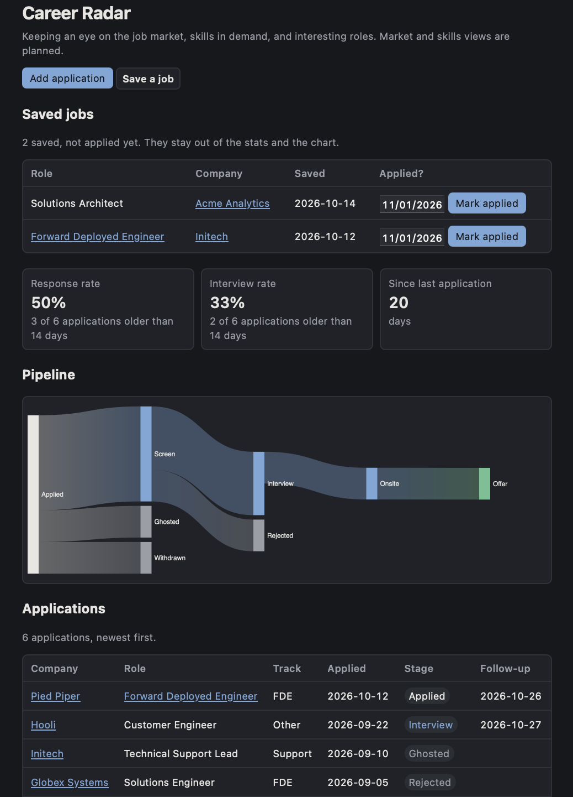

# Brain Dock

[](https://github.com/klaudialegu/brain-dock/actions/workflows/ci.yml)

**A modular personal daily-efficiency assistant: a small local-first core plus modules you can turn on and off. Built to production standards: tested, secured, and shipped in small reviewed slices.**



*Career Radar, with demo data only (fake companies).*

## Quick start (demo data)

<!-- quickstart:start -->
```sh
uv sync
uv run python -m brain_dock.importer --demo
BRAIN_DOCK_DB=data/demo.db uv run uvicorn brain_dock.main:app --host 127.0.0.1
```
<!-- quickstart:end -->

Open http://127.0.0.1:8000. Needs [uv](https://docs.astral.sh/uv/). CI runs these exact commands on a fresh clone. To fill the demo's inbox with synthetic job alerts: `uv run python -m brain_dock.modules.inbox.demo`.

## Modules

**Career Radar** (the first module; code name `job_search`): keeping an eye on the job market, skills in demand, and interesting roles.
- **Applications**: add, edit and record stages, with each application's history.
- **Saved jobs**: save a job you're considering, then mark it applied; saved jobs stay out of the stats until then.
- **Pipeline**: a Sankey chart of how applications moved through stages.
- **Stats**: response rate, interview rate, days since the last application.
- **Market trends and skills in demand** *(planned)*: what job alerts say about roles and skills over time.

**Inbox**
- **Triage**: job-alert emails are checked by plain-Python rules first; each suggestion waits for my approve or reject, and every skip keeps its reason. An accepted role links to a prefilled "Save a job" form in Career Radar; the inbox itself writes nothing there ([ADR 0011](docs/decisions/0011-inbox-writes-stay-in-the-inbox.md)).

**Planned** (not built yet)
- **Daily brief** *(planned)*: one morning page that pulls from every module. The first piece exists: a short text brief (counts and dates) that `uv run python -m brain_dock.brief` prints, and the optional morning show below reads aloud.
- **Projects and learning** *(planned)*: side projects and what I'm learning, in one place.

**Every module gets, from the core**
- **Backups**: one command writes a complete, validated JSON backup.
- **Local only**: no accounts, no cloud; pages load nothing from other sites. The one exception is the optional morning show, off unless you turn it on.
- **On or off**: `BRAIN_DOCK_MODULES` turns a module off without touching its data ([usage](docs/usage.md#modules)).

## Engineering highlights

- **Agent harness, safety first**: each agent run gets a least-privilege tool pass; writes wait for my approval and run exactly once; a hash-chained audit log; a network guard so the only way out is the model API; budgets and kill switches. ([ADR 0008](docs/decisions/0008-agent-harness.md))
- **Core + modules**: a small core plus removable modules, each with a manifest and its own migrations; CI runs the app with each module turned off. ([ADR 0007](docs/decisions/0007-core-and-modules.md))
- **Database as source of truth**: migrations, atomic validated backups, an importer that won't wipe data. ([ADR 0004](docs/decisions/0004-database-as-source-of-truth.md))
- **Localhost security**: CSRF, DNS-rebinding protection, strict CSP, errors that never echo input. ([ADR 0005](docs/decisions/0005-form-security-on-a-localhost-app.md))
- **Tests that prove themselves**: every security and data-writing check is broken on purpose once to show the tests catch it.
- **Supply chain**: vendored, checksummed chart library; SHA-pinned actions; Dependabot.
- **How it's built**: Claude Code works from written rules ([CLAUDE.md](CLAUDE.md)), reusable skills and an independent reviewer agent. Every slice has a plan with its exact test list ([docs/design/](docs/design/)), and the merged PRs show the process step by step.

## Why I built it

I'm a support engineer growing my agentic development skills by building something I use every day. Brain Dock is where I practice working with an AI pair programmer the way I'd want to ship for a customer: written rules, small slices, tests that are broken on purpose to prove they work, recorded decisions, and an independent review before anything risky. Career Radar is the first module.

## Morning show (optional)

A voice feature that reads a short morning script aloud with [ElevenLabs](https://elevenlabs.io) text-to-speech: a greeting, today's weather, today's workout from a Runna calendar feed, job counts, and a sign-off. It's off by default ([ADR 0013](docs/decisions/0013-spoken-brief-with-elevenlabs.md), [ADR 0014](docs/decisions/0014-morning-show.md)).

**What leaves your Mac when it's on:**
- **ElevenLabs** gets the script text only: your greeting name (if you set one), the weather numbers, the workout's name, minutes and distance, and job counts. Anything shaped like a secret is masked first. ElevenLabs keeps text and audio by default under its privacy policy (zero retention is for enterprise accounts only).
- **Open-Meteo** gets your coordinates rounded to about 10 km. Their server logs may keep them for 90 days.
- **Runna's calendar feed** is read (read-only). Its address stays in your keychain, and only today's workout is used.

Nothing else is sent. No event notes, locations, feed addresses or exact coordinates ever reach ElevenLabs.

1. Store your ElevenLabs API key in the macOS keychain. It asks at a hidden prompt, so the key never lands in a file or your shell history:
   `security add-generic-password -s brain-dock-elevenlabs -a brain-dock -w`
2. Optional, for the workout: in Runna, go to Connected Apps & Devices → Calendars → Other Calendar and copy the calendar address. Store it the same way:
   `security add-generic-password -s brain-dock-runna-ics -a brain-dock -w`
3. In `config.toml`, add `[voice]` with `enabled = true`, a `voice_id`, and optionally `greeting_name`, `weather_latitude` and `weather_longitude` (see `config.example.toml`). `uv run python -m brain_dock.voice --voices` lists the voices your key can use.
4. Check exactly what would be sent, for free: `uv run python -m brain_dock.voice --dry-run`
5. Hear it: `uv run python -m brain_dock.voice`

**Credits:**
- The model is Eleven v3, falling back to Multilingual v2 if your plan can't use v3.
- A show is at most 420 characters (at most 420 credits). That's about 9,700 credits for 23 weekdays, under the free plan's 10,000.
- A local monthly counter stops at 9,800 characters, and at most 3 requests go out a day.
- The same script is never generated twice: audio is cached in `data/voice_cache/`, owner-only, for 7 days, and the forecast is cached for the morning.
- macOS only (playback uses `afplay`).

## Where it's going (roadmap)

- A model judge for the inbox, with versioned prompts and an offline eval in CI.
- A flight-recorder page that replays any agent run.
- A daily brief that pulls from every module.

## More

- [Using it with your own data, backups, stats](docs/usage.md)
- [Design decisions](docs/decisions/)
- [Threat model](THREAT_MODEL.md): what's sensitive, what agents may never do, and what enforces each rule
- Development: `uv run pytest`, `uv run ruff check .`, `uv run ruff format .`, `scripts/check_quickstart.sh`
- Browser tests (the Safari checklist in WebKit, on a throwaway demo database): `uv run playwright install webkit` once, then `uv run pytest e2e`. Screenshots and an `index.html` land in `e2e-artifacts/`.

## License

[MIT](LICENSE)
