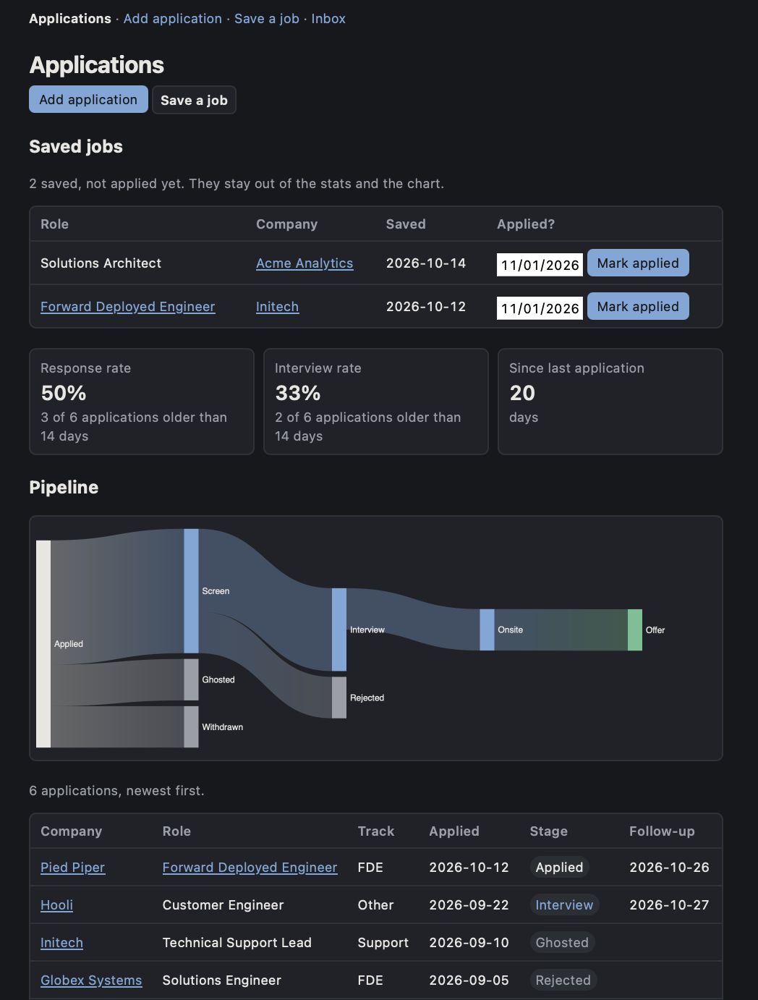

# Brain Dock

[](https://github.com/klaudialegu/brain-dock/actions/workflows/ci.yml)

**A local-first job-search tracker, built to production standards: tested, secured, and shipped in small reviewed slices.**



*Demo data only (fake companies).*

## Quick start (demo data)

<!-- quickstart:start -->
```sh
uv sync
uv run python -m brain_dock.importer --demo
BRAIN_DOCK_DB=data/demo.db uv run uvicorn brain_dock.main:app --host 127.0.0.1
```
<!-- quickstart:end -->

Open http://127.0.0.1:8000. Needs [uv](https://docs.astral.sh/uv/). CI runs these exact commands on a fresh clone. To fill the demo's inbox with synthetic job alerts: `uv run python -m brain_dock.modules.inbox.demo`.

## Features

- **Applications**: add, edit and record stages, with each application's history.
- **Saved jobs**: save a job you're considering, then mark it applied; saved jobs stay out of the stats until then.
- **Pipeline**: a Sankey chart of how applications moved through stages.
- **Stats**: response rate, interview rate, days since the last application.
- **Inbox triage**: job-alert emails are checked by plain-Python rules first; each suggestion waits for my approve or reject, and every skip keeps its reason.
- **Backups**: one command writes a complete, validated JSON backup.
- **Local only**: no accounts, no cloud; pages load nothing from other sites.

## Engineering highlights

- **Agent harness, safety first**: each agent run gets a least-privilege tool pass; writes wait for my approval and run exactly once; a hash-chained audit log; a network guard so the only way out is the model API; budgets and kill switches. ([ADR 0008](docs/decisions/0008-agent-harness.md))
- **Core + modules**: a small core plus removable modules, each with a manifest and its own migrations; CI runs the app with each module turned off. ([ADR 0007](docs/decisions/0007-core-and-modules.md))
- **Database as source of truth**: migrations, atomic validated backups, an importer that won't wipe data. ([ADR 0004](docs/decisions/0004-database-as-source-of-truth.md))
- **Localhost security**: CSRF, DNS-rebinding protection, strict CSP, errors that never echo input. ([ADR 0005](docs/decisions/0005-form-security-on-a-localhost-app.md))
- **Tests that prove themselves**: every security and data-writing check is broken on purpose once to show the tests catch it.
- **Supply chain**: vendored, checksummed chart library; SHA-pinned actions; Dependabot.
- **How it's built**: Claude Code works from written rules ([CLAUDE.md](CLAUDE.md)), reusable skills and an independent reviewer agent. Every slice has a plan with its exact test list ([docs/design/](docs/design/)), and the merged PRs show the process step by step.

## Why I built it

I'm a support engineer growing my agentic development skills by building something I use every day. Brain Dock is where I practice working with an AI pair programmer the way I'd want to ship for a customer: written rules, small slices, tests that are broken on purpose to prove they work, recorded decisions, and an independent review before anything risky. Job search is the first module.

## Where it's going (roadmap)

- A model judge for the inbox, with versioned prompts and an offline eval in CI.
- A flight-recorder page that replays any agent run.
- A daily brief that pulls from every module.

## More

- [Using it with your own data, backups, stats](docs/usage.md)
- [Design decisions](docs/decisions/)
- Development: `uv run pytest`, `uv run ruff check .`, `uv run ruff format .`, `scripts/check_quickstart.sh`

## License

[MIT](LICENSE)
